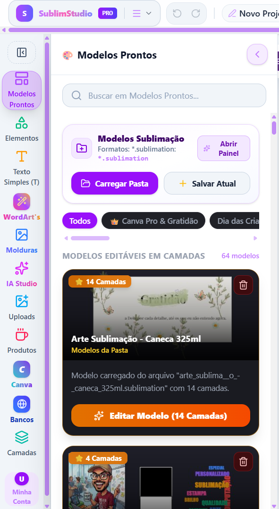
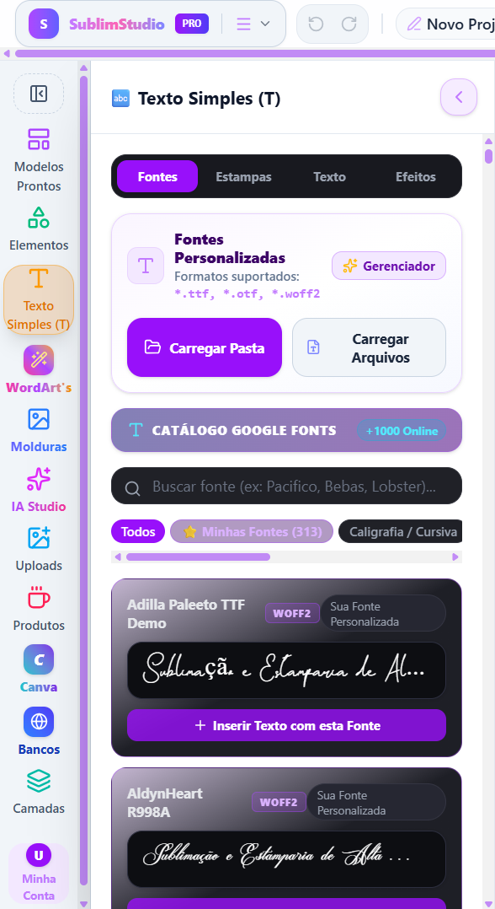
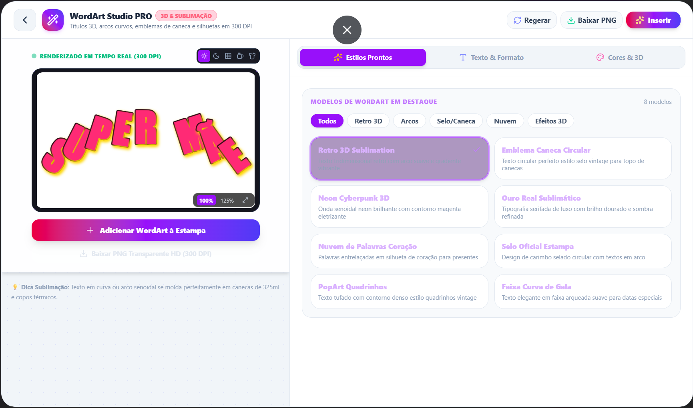
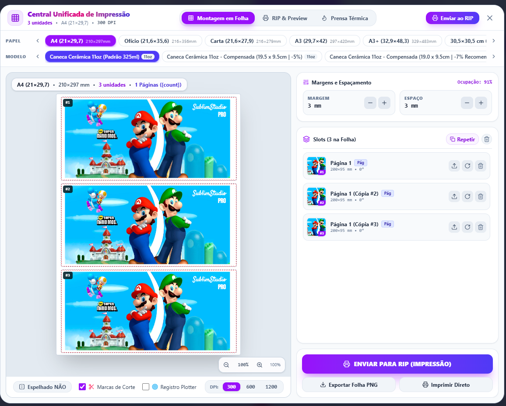
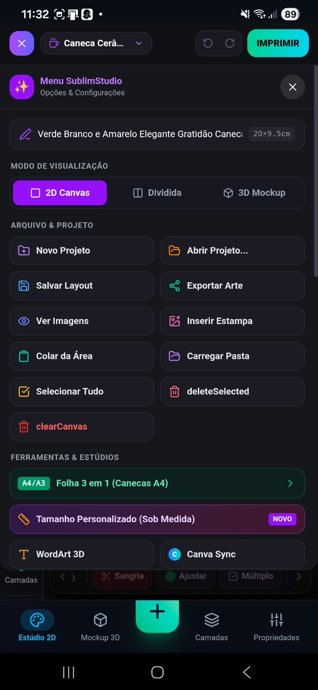

<p align="center">
  <a href="#-português-pt-br">Português (PT-BR)</a> •
  <a href="#-english-en">English (EN)</a> •
  <a href="#-español-es">Español (ES)</a> •
  <a href="#-français-fr">Français (FR)</a> •
  <a href="#-العربية-ar">العربية (AR)</a> •
  <a href="#-deutsch-de">Deutsch (DE)</a> •
  <a href="#-日本語-ja">日本語 (JA)</a> •
  <a href="#-中文-zh">中文 (ZH)</a> •
  <a href="#-한국어-ko">한국어 (KO)</a> •
  <a href="#-русский-ru">Русский (RU)</a>
</p>
---
🇧🇷 Português (PT-BR)
<p align="center">
  
</p>
<h1 align="center">SublimStudio Pro</h1>
<p align="center">
  <strong>Editor profissional de criação visual, personalização e preparação para sublimação.</strong>
</p>
<p align="center">
  <a href="https://ai-sublimation-studio-pro.ai.studio">🚀 Aplicação Online</a> •
  <a href="https://github.com/ruitobias-eng/AI-Sublimation-Studio-Pro">💻 GitHub</a>
</p>
---
📌 Sobre o Projeto
O SublimStudio Pro é uma plataforma de criação visual desenvolvida para profissionais de sublimação, personalização, estamparia, brindes, gráfica rápida e design.
A proposta é reunir em um único ambiente ferramentas de edição 2D, tipografia avançada, geração de elementos gráficos, inteligência artificial, bancos de imagens, mockups 3D e preparação de arquivos para impressão.
> **Desenvolvimento:** diBiTech®  
> **Desenvolvedores:** Rui Tobias Carvalho & Rodrigo Carvalho
---
✨ Principais Recursos
🎨 Editor de Estampas e Produtos: Área de trabalho 2D, camadas, guias, margem de segurança e sangria para preparação de arquivos em alta resolução.
🔤 WordArt Studio PRO: Efeitos 3D, neon, retrô, metálicos, textos curvados e integração com Google Fonts e fontes locais OTF, TTF e WOFF2.
☁️ Word Cloud Generator: Gerador de nuvem de palavras com formas de caneca, camiseta, coração, escudo, estrela, coroa, chama e outras formas.
🔳 QR Code Art: Criação de QR Codes estilizados para links, Wi-Fi, WhatsApp, e-mail e VCard, com exportação em SVG/PNG.
🤖 AI Studio: Geração de imagens por inteligência artificial para estamparia, produtos personalizados, padrões e projetos criativos.
🖼️ Bancos de Imagens HD: Recursos visuais e elementos gráficos integrados ao fluxo de personalização e design.
🧊 Mockup 3D em Tempo Real: Visualização interativa da arte aplicada em produtos tridimensionais, incluindo canecas, camisetas e produtos cônicos.
🖨️ Central de Impressão: Organização de trabalhos, nesting para melhor aproveitamento de papel, formatos A4/A3/A3+, marcas de corte, espelhamento e preparação para impressão.
---
🖼️ Galeria de Screenshots
<table>
  <tr>
    <th align="center">Interface Principal</th>
    <th align="center">WordArt Studio PRO</th>
  </tr>
  <tr>
    <td align="center"></td>
    <td align="center"></td>
  </tr>
</table>
<table>
  <tr>
    <th align="center">Nuvem de Palavras</th>
    <th align="center">Elementos e Formas</th>
  </tr>
  <tr>
    <td align="center"></td>
    <td align="center"></td>
  </tr>
</table>
<table>
  <tr>
    <th align="center">Mockup 3D</th>
    <th align="center">Central de Impressão (Nesting)</th>
  </tr>
  <tr>
    <td align="center"></td>
    <td align="center"></td>
  </tr>
</table>
<table>
  <tr>
    <th align="center">SublimStudio Pro — 15</th>
    <th align="center">SublimStudio Pro — 16</th>
  </tr>
  <tr>
    <td align="center"></td>
    <td align="center"></td>
  </tr>
</table>
<table>
  <tr>
    <th align="center">SublimStudio Pro — 17</th>
    <th align="center"></th>
  </tr>
  <tr>
    <td align="center"></td>
    <td align="center"></td>
  </tr>
</table>
---
🛠️ Tecnologias Utilizadas
Interface: React + TypeScript + Vite + Tailwind CSS
Estado Global: Zustand
Gráficos e 3D: Canvas API, SVG, Three.js e WebGL
Performance: Web Workers e PWA
Arquitetura: Aplicação web responsiva com suporte a desktop, tablet e dispositivos móveis
---
🚀 Executando Localmente
```bash
# Clonar o repositório
git clone https://github.com/ruitobias-eng/AI-Sublimation-Studio-Pro.git

# Entrar no repositório
cd AI-Sublimation-Studio-Pro

# Instalar dependências
npm install

# Executar o ambiente de desenvolvimento
npm run dev
```
---
🇺🇸 English (EN)
<p align="center">
  
</p>
<h1 align="center">SublimStudio Pro</h1>
<p align="center">
  <strong>Professional visual editor for design, customization, and sublimation preparation.</strong>
</p>
<p align="center">
  <a href="https://ai-sublimation-studio-pro.ai.studio">🚀 Live Web App</a> •
  <a href="https://github.com/ruitobias-eng/AI-Sublimation-Studio-Pro">💻 GitHub Repository</a>
</p>
---
📌 About the Project
SublimStudio Pro is a visual creation platform designed for professionals in sublimation, custom products, apparel decoration, promotional products, quick print shops, and graphic design.
It brings 2D editing tools, advanced typography, graphic element generation, artificial intelligence, image resources, 3D mockups, and print preparation into a single workspace.
> **Development:** diBiTech®  
> **Developers:** Rui Tobias Carvalho & Rodrigo Carvalho
---
✨ Key Features
🎨 Print & Product Editor: 2D workspace with layers, guides, safety margins, and bleed for high-resolution artwork preparation.
🔤 WordArt Studio PRO: 3D, neon, retro, metallic, and curved text effects, with Google Fonts and local OTF, TTF, and WOFF2 font support.
☁️ Word Cloud Generator: Typography clouds shaped as mugs, T-shirts, hearts, shields, stars, crowns, flames, and other shapes.
🔳 QR Code Art: Styled QR codes for links, Wi-Fi, WhatsApp, email, and vCards, with SVG/PNG export.
🤖 AI Studio: AI-powered image generation for sublimation, custom products, patterns, and creative projects.
🖼️ HD Image Resources: Visual resources and graphic elements integrated into the customization and design workflow.
🧊 Real-Time 3D Mockup: Interactive artwork previews on three-dimensional products, including mugs, apparel, and conical products.
🖨️ Print Hub: Artwork organization, nesting for better paper usage, A4/A3/A3+ formats, crop marks, mirroring, and print preparation.
---
🖼️ Screenshots Gallery
<table>
  <tr>
    <th align="center">Main Interface</th>
    <th align="center">WordArt Studio PRO</th>
  </tr>
  <tr>
    <td align="center"></td>
    <td align="center"></td>
  </tr>
</table>
<table>
  <tr>
    <th align="center">Word Cloud Generator</th>
    <th align="center">Elements & Shapes</th>
  </tr>
  <tr>
    <td align="center"></td>
    <td align="center"></td>
  </tr>
</table>
<table>
  <tr>
    <th align="center">3D Mockup</th>
    <th align="center">Print Hub (Nesting)</th>
  </tr>
  <tr>
    <td align="center"></td>
    <td align="center"></td>
  </tr>
</table>
<table>
  <tr>
    <th align="center">SublimStudio Pro — 15</th>
    <th align="center">SublimStudio Pro — 16</th>
  </tr>
  <tr>
    <td align="center"></td>
    <td align="center"></td>
  </tr>
</table>
<table>
  <tr>
    <th align="center">SublimStudio Pro — 17</th>
    <th align="center"></th>
  </tr>
  <tr>
    <td align="center"></td>
    <td align="center"></td>
  </tr>
</table>
---
🛠️ Tech Stack
UI: React + TypeScript + Vite + Tailwind CSS
State Management: Zustand
Graphics & 3D: Canvas API, SVG, Three.js, and WebGL
Performance: Web Workers and PWA
Architecture: Responsive web application for desktop, tablet, and mobile devices
---
🚀 Local Setup
```bash
# Clone the repository
git clone https://github.com/ruitobias-eng/AI-Sublimation-Studio-Pro.git

# Navigate to the project
cd AI-Sublimation-Studio-Pro

# Install dependencies
npm install

# Run the development server
npm run dev
```
---
🇪🇸 Español (ES)
<p align="center">
  
</p>
<h1 align="center">SublimStudio Pro</h1>
<p align="center">
  <strong>Editor profesional de creación visual, personalización y preparación para sublimación.</strong>
</p>
<p align="center">
  <a href="https://ai-sublimation-studio-pro.ai.studio">🚀 Aplicación en Línea</a> •
  <a href="https://github.com/ruitobias-eng/AI-Sublimation-Studio-Pro">💻 GitHub</a>
</p>
---
📌 Sobre el Proyecto
SublimStudio Pro es una plataforma de creación visual desarrollada para profesionales de la sublimación, personalización de productos, confección, artículos promocionales, imprentas rápidas y diseño gráfico.
El objetivo es reunir en un solo lugar herramientas de edición 2D, tipografía avanzada, generación de elementos gráficos, inteligencia artificial, recursos de imágenes, maquetas 3D y preparación de archivos para impresión.
> **Desarrollo:** diBiTech®  
> **Desarrolladores:** Rui Tobias Carvalho & Rodrigo Carvalho
---
✨ Características Principales
🎨 Editor de Diseños y Productos: Área de trabajo 2D con capas, guías, márgenes de seguridad y sangría para preparar archivos en alta resolución.
🔤 WordArt Studio PRO: Efectos 3D, neón, retro, metálicos y textos curvados, con compatibilidad con Google Fonts y fuentes OTF, TTF y WOFF2.
☁️ Generador de Nubes de Palabras: Nubes tipográficas con formas de tazas, camisetas, corazones, escudos, estrellas, coronas, llamas y otras formas.
🔳 QR Code Art: Creación de códigos QR estilizados para enlaces, Wi-Fi, WhatsApp, correo electrónico y vCards, con exportación SVG/PNG.
🤖 AI Studio: Generación de imágenes mediante inteligencia artificial para sublimación, productos personalizados, patrones y proyectos creativos.
🖼️ Recursos de Imágenes HD: Imágenes y elementos gráficos integrados en el flujo de personalización y diseño.
🧊 Mockup 3D en Tiempo Real: Vista interactiva de diseños aplicados en productos tridimensionales, incluyendo tazas, camisetas y productos cónicos.
🖨️ Central de Impresión: Organización de trabajos, nesting para aprovechar mejor el papel, formatos A4/A3/A3+, marcas de corte, espejado y preparación para impresión.
---
🖼️ Galería de Capturas
<table>
  <tr>
    <th align="center">Interfaz Principal</th>
    <th align="center">WordArt Studio PRO</th>
  </tr>
  <tr>
    <td align="center"></td>
    <td align="center"></td>
  </tr>
</table>
<table>
  <tr>
    <th align="center">Generador de Nubes de Palabras</th>
    <th align="center">Elementos y Formas</th>
  </tr>
  <tr>
    <td align="center"></td>
    <td align="center"></td>
  </tr>
</table>
<table>
  <tr>
    <th align="center">Mockup 3D</th>
    <th align="center">Central de Impresión (Nesting)</th>
  </tr>
  <tr>
    <td align="center"></td>
    <td align="center"></td>
  </tr>
</table>
<table>
  <tr>
    <th align="center">SublimStudio Pro — 15</th>
    <th align="center">SublimStudio Pro — 16</th>
  </tr>
  <tr>
    <td align="center"></td>
    <td align="center"></td>
  </tr>
</table>
<table>
  <tr>
    <th align="center">SublimStudio Pro — 17</th>
    <th align="center"></th>
  </tr>
  <tr>
    <td align="center"></td>
    <td align="center"></td>
  </tr>
</table>
---
🛠️ Tecnologías Utilizadas
Interfaz: React + TypeScript + Vite + Tailwind CSS
Gestión del Estado: Zustand
Gráficos y 3D: Canvas API, SVG, Three.js y WebGL
Rendimiento: Web Workers y PWA
Arquitectura: Aplicación web responsiva para escritorio, tabletas y dispositivos móviles
---
🚀 Instalación Local
```bash
# Clonar el repositorio
git clone https://github.com/ruitobias-eng/AI-Sublimation-Studio-Pro.git

# Entrar al directorio del proyecto
cd AI-Sublimation-Studio-Pro

# Instalar dependencias
npm install

# Iniciar el servidor de desarrollo
npm run dev
```
---
🇫🇷 Français (FR)
<p align="center">
  
</p>
<h1 align="center">SublimStudio Pro</h1>
<p align="center">
  <strong>Éditeur professionnel de création visuelle, de personnalisation et de préparation à la sublimation.</strong>
</p>
<p align="center">
  <a href="https://ai-sublimation-studio-pro.ai.studio">🚀 Application en ligne</a> •
  <a href="https://github.com/ruitobias-eng/AI-Sublimation-Studio-Pro">💻 GitHub</a>
</p>
---
📌 À propos du projet
SublimStudio Pro est une plateforme de création visuelle destinée aux professionnels de la sublimation, de la personnalisation, de l’impression textile, des objets promotionnels, de l’impression rapide et du design graphique.
Elle réunit dans un même espace l’édition 2D, la typographie avancée, la génération d’éléments graphiques, l’intelligence artificielle, les ressources d’images, les maquettes 3D et la préparation des fichiers pour l’impression.
> **Développement :** diBiTech®  
> **Développeurs :** Rui Tobias Carvalho & Rodrigo Carvalho
---
✨ Fonctionnalités principales
🎨 Éditeur de designs et de produits : espace de travail 2D, calques, repères, marges de sécurité et fond perdu pour les fichiers haute résolution.
🔤 WordArt Studio PRO : effets 3D, néon, rétro, métalliques et textes courbés, avec prise en charge de Google Fonts et des polices OTF, TTF et WOFF2.
☁️ Générateur de nuages de mots : compositions en forme de tasses, tee-shirts, cœurs, écus, étoiles, couronnes, flammes et autres formes.
🔳 QR Code Art : création de QR Codes stylisés pour liens, Wi-Fi, WhatsApp, e-mail et vCards, avec export SVG/PNG.
🤖 AI Studio : génération d’images par intelligence artificielle pour la sublimation et les produits personnalisés.
🖼️ Ressources d’images HD : images et éléments graphiques intégrés au flux de personnalisation et de design.
🧊 Maquette 3D en temps réel : aperçu interactif des créations sur des produits tridimensionnels, notamment des tasses, vêtements et objets coniques.
🖨️ Centre d’impression : organisation des travaux, nesting, formats A4/A3/A3+, repères de coupe, miroir et préparation à l’impression.
---
🖼️ Galerie de captures
<table>
  <tr>
    <th align="center">Interface principale</th>
    <th align="center">WordArt Studio PRO</th>
  </tr>
  <tr>
    <td align="center"></td>
    <td align="center"></td>
  </tr>
</table>
<table>
  <tr>
    <th align="center">Nuage de mots</th>
    <th align="center">Éléments et formes</th>
  </tr>
  <tr>
    <td align="center"></td>
    <td align="center"></td>
  </tr>
</table>
<table>
  <tr>
    <th align="center">Maquette 3D</th>
    <th align="center">Centre d’impression (Nesting)</th>
  </tr>
  <tr>
    <td align="center"></td>
    <td align="center"></td>
  </tr>
</table>
<table>
  <tr>
    <th align="center">SublimStudio Pro — 15</th>
    <th align="center">SublimStudio Pro — 16</th>
  </tr>
  <tr>
    <td align="center"></td>
    <td align="center"></td>
  </tr>
</table>
<table>
  <tr>
    <th align="center">SublimStudio Pro — 17</th>
    <th align="center"></th>
  </tr>
  <tr>
    <td align="center"></td>
    <td align="center"></td>
  </tr>
</table>
---
🛠️ Technologies utilisées
Interface : React + TypeScript + Vite + Tailwind CSS
État global : Zustand
Graphismes et 3D : Canvas API, SVG, Three.js et WebGL
Performance : Web Workers et PWA
Architecture : application web responsive pour ordinateur, tablette et appareils mobiles
---
🚀 Installation locale
```bash
# Cloner le dépôt
git clone https://github.com/ruitobias-eng/AI-Sublimation-Studio-Pro.git

# Accéder au projet
cd AI-Sublimation-Studio-Pro

# Installer les dépendances
npm install

# Lancer le serveur de développement
npm run dev
```
---
🇸🇦 العربية (AR)
<p align="center">
  
</p>
<h1 align="center">SublimStudio Pro</h1>
<p align="center">
  <strong>محرر احترافي للتصميم المرئي وتخصيص المنتجات وتجهيز ملفات الطباعة بالتسامي.</strong>
</p>
<p align="center">
  <a href="https://ai-sublimation-studio-pro.ai.studio">🚀 التطبيق عبر الإنترنت</a> •
  <a href="https://github.com/ruitobias-eng/AI-Sublimation-Studio-Pro">💻 GitHub</a>
</p>
---
📌 حول المشروع
SublimStudio Pro منصة للتصميم المرئي مخصصة لمحترفي الطباعة بالتسامي، وتخصيص المنتجات، والطباعة على الملابس، والهدايا الترويجية، والطباعة السريعة، والتصميم الجرافيكي.
تجمع المنصة في مساحة واحدة أدوات التحرير ثنائي الأبعاد، والطباعة المتقدمة، وإنشاء العناصر الرسومية، والذكاء الاصطناعي، وموارد الصور، والنماذج ثلاثية الأبعاد، وتجهيز الملفات للطباعة.
> **التطوير:** diBiTech®  
> **المطوران:** Rui Tobias Carvalho وRodrigo Carvalho
---
✨ أهم الميزات
🎨 محرر التصاميم والمنتجات: مساحة عمل ثنائية الأبعاد، وطبقات، وأدلة، وهوامش أمان، وتجهيز ملفات عالية الدقة.
🔤 WordArt Studio PRO: تأثيرات ثلاثية الأبعاد، ونيون، وريترُو، ومعدنية، ونصوص منحنية، مع دعم Google Fonts وOTF وTTF وWOFF2.
☁️ مولد سحابة الكلمات: تكوينات على شكل أكواب، وقمصان، وقلوب، ودروع، ونجوم، وتيجان، ولهب، وأشكال أخرى.
🔳 QR Code Art: إنشاء رموز QR مخصصة للروابط وشبكات Wi-Fi وWhatsApp والبريد الإلكتروني وبطاقات vCard، مع تصدير SVG/PNG.
🤖 AI Studio: إنشاء صور بالذكاء الاصطناعي للطباعة بالتسامي والمنتجات المخصصة والمشاريع الإبداعية.
🖼️ موارد صور عالية الدقة: صور وعناصر رسومية مدمجة في سير عمل التصميم والتخصيص.
🧊 نموذج ثلاثي الأبعاد مباشر: معاينة تفاعلية للتصميم على الأكواب والملابس والمنتجات المخروطية وغيرها.
🖨️ مركز الطباعة: تنظيم الأعمال، وترتيب العناصر، وأحجام A4/A3/A3+، وعلامات القص، والانعكاس، وتجهيز الطباعة.
---
🖼️ معرض لقطات الشاشة
<table>
  <tr>
    <th align="center">الواجهة الرئيسية</th>
    <th align="center">WordArt Studio PRO</th>
  </tr>
  <tr>
    <td align="center"></td>
    <td align="center"></td>
  </tr>
</table>
<table>
  <tr>
    <th align="center">سحابة الكلمات</th>
    <th align="center">العناصر والأشكال</th>
  </tr>
  <tr>
    <td align="center"></td>
    <td align="center"></td>
  </tr>
</table>
<table>
  <tr>
    <th align="center">النموذج ثلاثي الأبعاد</th>
    <th align="center">مركز الطباعة (Nesting)</th>
  </tr>
  <tr>
    <td align="center"></td>
    <td align="center"></td>
  </tr>
</table>
<table>
  <tr>
    <th align="center">SublimStudio Pro — 15</th>
    <th align="center">SublimStudio Pro — 16</th>
  </tr>
  <tr>
    <td align="center"></td>
    <td align="center"></td>
  </tr>
</table>
<table>
  <tr>
    <th align="center">SublimStudio Pro — 17</th>
    <th align="center"></th>
  </tr>
  <tr>
    <td align="center"></td>
    <td align="center"></td>
  </tr>
</table>
---
🛠️ التقنيات المستخدمة
الواجهة: React وTypeScript وVite وTailwind CSS
إدارة الحالة: Zustand
الرسومات والأبعاد الثلاثية: Canvas API وSVG وThree.js وWebGL
الأداء: Web Workers وPWA
البنية: تطبيق ويب متجاوب لأجهزة الكمبيوتر والأجهزة اللوحية والهواتف المحمولة
---
🚀 التشغيل محليًا
```bash
# استنساخ المستودع
git clone https://github.com/ruitobias-eng/AI-Sublimation-Studio-Pro.git

# الدخول إلى المشروع
cd AI-Sublimation-Studio-Pro

# تثبيت التبعيات
npm install

# تشغيل خادم التطوير
npm run dev
```
---
🇩🇪 Deutsch (DE)
<p align="center">
  
</p>
<h1 align="center">SublimStudio Pro</h1>
<p align="center">
  <strong>Professioneller visueller Editor für Design, Personalisierung und Sublimationsvorbereitung.</strong>
</p>
<p align="center">
  <a href="https://ai-sublimation-studio-pro.ai.studio">🚀 Online-Anwendung</a> •
  <a href="https://github.com/ruitobias-eng/AI-Sublimation-Studio-Pro">💻 GitHub</a>
</p>
---
📌 Über das Projekt
SublimStudio Pro ist eine visuelle Kreativplattform für Fachleute aus Sublimationsdruck, Produktpersonalisierung, Textilveredelung, Werbeartikeln, Schnelldruck und Grafikdesign.
Die Plattform vereint 2D-Bearbeitung, fortgeschrittene Typografie, grafische Generatoren, künstliche Intelligenz, Bildressourcen, 3D-Mockups und Druckvorbereitung in einem Arbeitsbereich.
> **Entwicklung:** diBiTech®  
> **Entwickler:** Rui Tobias Carvalho & Rodrigo Carvalho
---
✨ Wichtigste Funktionen
🎨 Design- und Produkteditor: 2D-Arbeitsbereich, Ebenen, Hilfslinien, Sicherheitsabstände und Vorbereitung hochauflösender Dateien.
🔤 WordArt Studio PRO: 3D-, Neon-, Retro-, Metallic- und gebogene Texteffekte mit Unterstützung für Google Fonts sowie OTF-, TTF- und WOFF2-Schriften.
☁️ Word-Cloud-Generator: Typografische Kompositionen in Form von Tassen, T-Shirts, Herzen, Schilden, Sternen, Kronen, Flammen und anderen Formen.
🔳 QR Code Art: Gestaltete QR-Codes für Links, WLAN, WhatsApp, E-Mail und vCards mit SVG/PNG-Export.
🤖 AI Studio: KI-gestützte Bildgenerierung für Sublimation, personalisierte Produkte, Muster und kreative Projekte.
🖼️ HD-Bildressourcen: Bilder und grafische Elemente für den Personalisierungs- und Design-Workflow.
🧊 3D-Mockup in Echtzeit: Interaktive Vorschau auf Tassen, Kleidung, konischen Produkten und anderen 3D-Objekten.
🖨️ Druckzentrale: Arbeitsorganisation, Nesting, A4/A3/A3+-Formate, Schnittmarken, Spiegelung und Druckvorbereitung.
---
🖼️ Screenshot-Galerie
<table>
  <tr>
    <th align="center">Hauptoberfläche</th>
    <th align="center">WordArt Studio PRO</th>
  </tr>
  <tr>
    <td align="center"></td>
    <td align="center"></td>
  </tr>
</table>
<table>
  <tr>
    <th align="center">Word Cloud</th>
    <th align="center">Elemente und Formen</th>
  </tr>
  <tr>
    <td align="center"></td>
    <td align="center"></td>
  </tr>
</table>
<table>
  <tr>
    <th align="center">3D-Mockup</th>
    <th align="center">Druckzentrale (Nesting)</th>
  </tr>
  <tr>
    <td align="center"></td>
    <td align="center"></td>
  </tr>
</table>
<table>
  <tr>
    <th align="center">SublimStudio Pro — 15</th>
    <th align="center">SublimStudio Pro — 16</th>
  </tr>
  <tr>
    <td align="center"></td>
    <td align="center"></td>
  </tr>
</table>
<table>
  <tr>
    <th align="center">SublimStudio Pro — 17</th>
    <th align="center"></th>
  </tr>
  <tr>
    <td align="center"></td>
    <td align="center"></td>
  </tr>
</table>
---
🛠️ Verwendete Technologien
Oberfläche: React + TypeScript + Vite + Tailwind CSS
Zustandsverwaltung: Zustand
Grafik und 3D: Canvas API, SVG, Three.js und WebGL
Performance: Web Workers und PWA
Architektur: Responsive Webanwendung für Desktop, Tablet und Mobilgeräte
---
🚀 Lokale Einrichtung
```bash
# Repository klonen
git clone https://github.com/ruitobias-eng/AI-Sublimation-Studio-Pro.git

# Zum Projekt wechseln
cd AI-Sublimation-Studio-Pro

# Abhängigkeiten installieren
npm install

# Entwicklungsserver starten
npm run dev
```
---
🇯🇵 日本語 (JA)
<p align="center">
  
</p>
<h1 align="center">SublimStudio Pro</h1>
<p align="center">
  <strong>デザイン、カスタマイズ、昇華転写用データの準備に対応したプロ向けビジュアルエディター。</strong>
</p>
<p align="center">
  <a href="https://ai-sublimation-studio-pro.ai.studio">🚀 オンラインアプリ</a> •
  <a href="https://github.com/ruitobias-eng/AI-Sublimation-Studio-Pro">💻 GitHub</a>
</p>
---
📌 プロジェクトについて
SublimStudio Pro は、昇華転写、製品カスタマイズ、アパレル印刷、販促品、短納期印刷、グラフィックデザインの専門家向けに開発されたビジュアル制作プラットフォームです。
2D編集、高度なタイポグラフィ、グラフィック要素の生成、AI、画像リソース、3Dモックアップ、印刷用データの準備を一つの環境に統合します。
> **開発:** diBiTech®  
> **開発者:** Rui Tobias Carvalho & Rodrigo Carvalho
---
✨ 主な機能
🎨 デザイン・製品エディター: 2Dワークスペース、レイヤー、ガイド、安全マージン、高解像度データの準備。
🔤 WordArt Studio PRO: 3D、ネオン、レトロ、メタリック、曲線テキストの効果に対応。Google Fonts、OTF、TTF、WOFF2を利用可能。
☁️ ワードクラウド生成: マグカップ、Tシャツ、ハート、盾、星、王冠、炎などの形で文字を構成。
🔳 QR Code Art: リンク、Wi-Fi、WhatsApp、メール、vCard用のスタイル付きQRコードを作成し、SVG/PNGで出力。
🤖 AI Studio: 昇華転写、カスタム製品、パターン、クリエイティブ制作向けのAI画像生成。
🖼️ HD画像リソース: カスタマイズとデザインのワークフローで利用できる画像とグラフィック要素。
🧊 リアルタイム3Dモックアップ: マグカップ、衣類、円錐形製品などにデザインを適用した状態をインタラクティブに表示。
🖨️ プリントセンター: ジョブ整理、Nesting、A4/A3/A3+用紙、トンボ、反転、印刷準備。
---
🖼️ スクリーンショットギャラリー
<table>
  <tr>
    <th align="center">メインインターフェース</th>
    <th align="center">WordArt Studio PRO</th>
  </tr>
  <tr>
    <td align="center"></td>
    <td align="center"></td>
  </tr>
</table>
<table>
  <tr>
    <th align="center">ワードクラウド</th>
    <th align="center">要素と形状</th>
  </tr>
  <tr>
    <td align="center"></td>
    <td align="center"></td>
  </tr>
</table>
<table>
  <tr>
    <th align="center">3Dモックアップ</th>
    <th align="center">プリントセンター（Nesting）</th>
  </tr>
  <tr>
    <td align="center"></td>
    <td align="center"></td>
  </tr>
</table>
<table>
  <tr>
    <th align="center">SublimStudio Pro — 15</th>
    <th align="center">SublimStudio Pro — 16</th>
  </tr>
  <tr>
    <td align="center"></td>
    <td align="center"></td>
  </tr>
</table>
<table>
  <tr>
    <th align="center">SublimStudio Pro — 17</th>
    <th align="center"></th>
  </tr>
  <tr>
    <td align="center"></td>
    <td align="center"></td>
  </tr>
</table>
---
🛠️ 使用技術
インターフェース: React + TypeScript + Vite + Tailwind CSS
状態管理: Zustand
グラフィックスと3D: Canvas API、SVG、Three.js、WebGL
パフォーマンス: Web Workers、PWA
アーキテクチャ: デスクトップ、タブレット、モバイルに対応したレスポンシブWebアプリケーション
---
🚀 ローカルでの実行
```bash
# リポジトリをクローン
git clone https://github.com/ruitobias-eng/AI-Sublimation-Studio-Pro.git

# プロジェクトへ移動
cd AI-Sublimation-Studio-Pro

# 依存関係をインストール
npm install

# 開発サーバーを起動
npm run dev
```
---
🇨🇳 中文 (ZH)
<p align="center">
  
</p>
<h1 align="center">SublimStudio Pro</h1>
<p align="center">
  <strong>用于视觉设计、产品定制和热升华打印准备的专业编辑器。</strong>
</p>
<p align="center">
  <a href="https://ai-sublimation-studio-pro.ai.studio">🚀 在线应用</a> •
  <a href="https://github.com/ruitobias-eng/AI-Sublimation-Studio-Pro">💻 GitHub</a>
</p>
---
📌 项目简介
SublimStudio Pro 是面向热升华打印、产品定制、服装印花、促销礼品、快速印刷和图形设计专业人士的视觉创作平台。
平台将二维编辑、高级字体、图形元素生成、人工智能、图像资源、三维模型预览和打印文件准备整合到一个工作空间中。
> **开发方：** diBiTech®  
> **开发者：** Rui Tobias Carvalho & Rodrigo Carvalho
---
✨ 主要功能
🎨 设计与产品编辑器： 二维工作区、图层、辅助线、安全边距以及高分辨率文件准备。
🔤 WordArt Studio PRO： 支持 3D、霓虹、复古、金属和弯曲文字效果，以及 Google Fonts、OTF、TTF 和 WOFF2 字体。
☁️ 文字云生成器： 支持杯子、T 恤、心形、盾牌、星星、王冠、火焰等形状。
🔳 QR Code Art： 为链接、Wi-Fi、WhatsApp、电子邮件和 vCard 创建样式化二维码，并支持 SVG/PNG 导出。
🤖 AI Studio： 面向热升华、定制产品、图案和创意项目的 AI 图像生成。
🖼️ 高清图像资源： 将图像和图形元素融入定制与设计流程。
🧊 实时 3D 模型预览： 在杯子、服装、锥形产品及其他三维产品上交互式预览设计。
🖨️ 打印中心： 任务组织、Nesting、A4/A3/A3+ 纸张、裁切标记、镜像和打印准备。
---
🖼️ 截图画廊
<table>
  <tr>
    <th align="center">主界面</th>
    <th align="center">WordArt Studio PRO</th>
  </tr>
  <tr>
    <td align="center"></td>
    <td align="center"></td>
  </tr>
</table>
<table>
  <tr>
    <th align="center">文字云</th>
    <th align="center">元素与形状</th>
  </tr>
  <tr>
    <td align="center"></td>
    <td align="center"></td>
  </tr>
</table>
<table>
  <tr>
    <th align="center">3D 模型预览</th>
    <th align="center">打印中心（Nesting）</th>
  </tr>
  <tr>
    <td align="center"></td>
    <td align="center"></td>
  </tr>
</table>
<table>
  <tr>
    <th align="center">SublimStudio Pro — 15</th>
    <th align="center">SublimStudio Pro — 16</th>
  </tr>
  <tr>
    <td align="center"></td>
    <td align="center"></td>
  </tr>
</table>
<table>
  <tr>
    <th align="center">SublimStudio Pro — 17</th>
    <th align="center"></th>
  </tr>
  <tr>
    <td align="center"></td>
    <td align="center"></td>
  </tr>
</table>
---
🛠️ 使用技术
界面： React + TypeScript + Vite + Tailwind CSS
状态管理： Zustand
图形与 3D： Canvas API、SVG、Three.js 和 WebGL
性能： Web Workers 和 PWA
架构： 支持桌面、平板和移动设备的响应式 Web 应用
---
🚀 本地运行
```bash
# 克隆仓库
git clone https://github.com/ruitobias-eng/AI-Sublimation-Studio-Pro.git

# 进入项目目录
cd AI-Sublimation-Studio-Pro

# 安装依赖
npm install

# 启动开发服务器
npm run dev
```
---
🇰🇷 한국어 (KO)
<p align="center">
  
</p>
<h1 align="center">SublimStudio Pro</h1>
<p align="center">
  <strong>시각 디자인, 제품 커스터마이징 및 승화전사 인쇄 준비를 위한 전문 편집기입니다.</strong>
</p>
<p align="center">
  <a href="https://ai-sublimation-studio-pro.ai.studio">🚀 온라인 애플리케이션</a> •
  <a href="https://github.com/ruitobias-eng/AI-Sublimation-Studio-Pro">💻 GitHub</a>
</p>
---
📌 프로젝트 소개
SublimStudio Pro는 승화전사, 제품 커스터마이징, 의류 프린팅, 판촉물, 빠른 인쇄 및 그래픽 디자인 전문가를 위한 비주얼 제작 플랫폼입니다.
2D 편집 도구, 고급 타이포그래피, 그래픽 요소 생성, 인공지능, 이미지 리소스, 3D 목업 및 인쇄 파일 준비 기능을 하나의 작업 공간에 통합합니다.
> **개발:** diBiTech®  
> **개발자:** Rui Tobias Carvalho & Rodrigo Carvalho
---
✨ 주요 기능
🎨 디자인 및 제품 편집기: 2D 작업 공간, 레이어, 가이드, 안전 여백 및 고해상도 파일 준비.
🔤 WordArt Studio PRO: 3D, 네온, 레트로, 메탈릭 및 곡선 텍스트 효과와 Google Fonts, OTF, TTF, WOFF2 지원.
☁️ 워드 클라우드 생성기: 머그컵, 티셔츠, 하트, 방패, 별, 왕관, 불꽃 및 다양한 형태 지원.
🔳 QR Code Art: 링크, Wi-Fi, WhatsApp, 이메일 및 vCard용 스타일 QR 코드를 만들고 SVG/PNG로 내보내기.
🤖 AI Studio: 승화전사, 맞춤 제품, 패턴 및 창의적인 프로젝트를 위한 AI 이미지 생성.
🖼️ HD 이미지 리소스: 커스터마이징과 디자인 작업에 사용할 수 있는 이미지 및 그래픽 요소.
🧊 실시간 3D 목업: 머그컵, 의류, 원뿔형 제품 및 기타 3D 제품에 적용된 디자인을 대화형으로 미리보기.
🖨️ 인쇄 센터: 작업 정리, Nesting, A4/A3/A3+ 용지, 재단 표시, 좌우 반전 및 인쇄 준비.
---
🖼️ 스크린샷 갤러리
<table>
  <tr>
    <th align="center">메인 인터페이스</th>
    <th align="center">WordArt Studio PRO</th>
  </tr>
  <tr>
    <td align="center"></td>
    <td align="center"></td>
  </tr>
</table>
<table>
  <tr>
    <th align="center">워드 클라우드</th>
    <th align="center">요소 및 형태</th>
  </tr>
  <tr>
    <td align="center"></td>
    <td align="center"></td>
  </tr>
</table>
<table>
  <tr>
    <th align="center">3D 목업</th>
    <th align="center">인쇄 센터 (Nesting)</th>
  </tr>
  <tr>
    <td align="center"></td>
    <td align="center"></td>
  </tr>
</table>
<table>
  <tr>
    <th align="center">SublimStudio Pro — 15</th>
    <th align="center">SublimStudio Pro — 16</th>
  </tr>
  <tr>
    <td align="center"></td>
    <td align="center"></td>
  </tr>
</table>
<table>
  <tr>
    <th align="center">SublimStudio Pro — 17</th>
    <th align="center"></th>
  </tr>
  <tr>
    <td align="center"></td>
    <td align="center"></td>
  </tr>
</table>
---
🛠️ 사용 기술
인터페이스: React + TypeScript + Vite + Tailwind CSS
상태 관리: Zustand
그래픽 및 3D: Canvas API, SVG, Three.js, WebGL
성능: Web Workers 및 PWA
아키텍처: 데스크톱, 태블릿 및 모바일 기기를 지원하는 반응형 웹 애플리케이션
---
🚀 로컬 실행
```bash
# 저장소 복제
git clone https://github.com/ruitobias-eng/AI-Sublimation-Studio-Pro.git

# 프로젝트 폴더로 이동
cd AI-Sublimation-Studio-Pro

# 의존성 설치
npm install

# 개발 서버 실행
npm run dev
```
---
🇷🇺 Русский (RU)
<p align="center">
  
</p>
<h1 align="center">SublimStudio Pro</h1>
<p align="center">
  <strong>Профессиональный визуальный редактор для дизайна, персонализации и подготовки к сублимационной печати.</strong>
</p>
<p align="center">
  <a href="https://ai-sublimation-studio-pro.ai.studio">🚀 Онлайн-приложение</a> •
  <a href="https://github.com/ruitobias-eng/AI-Sublimation-Studio-Pro">💻 GitHub</a>
</p>
---
📌 О проекте
SublimStudio Pro — платформа визуального творчества для специалистов по сублимационной печати, персонализации продукции, нанесению изображений на одежду, рекламным сувенирам, быстрой печати и графическому дизайну.
Платформа объединяет 2D-редактирование, продвинутую типографику, создание графических элементов, искусственный интеллект, ресурсы изображений, 3D-мокапы и подготовку файлов к печати в одном рабочем пространстве.
> **Разработка:** diBiTech®  
> **Разработчики:** Rui Tobias Carvalho & Rodrigo Carvalho
---
✨ Основные возможности
🎨 Редактор дизайна и продукции: 2D-рабочая область, слои, направляющие, безопасные поля и подготовка файлов высокого разрешения.
🔤 WordArt Studio PRO: 3D-, неоновые, ретро-, металлические и изогнутые текстовые эффекты с поддержкой Google Fonts, OTF, TTF и WOFF2.
☁️ Генератор облака слов: композиции в форме кружек, футболок, сердец, щитов, звезд, корон, языков пламени и других фигур.
🔳 QR Code Art: стилизованные QR-коды для ссылок, Wi-Fi, WhatsApp, электронной почты и vCard с экспортом в SVG/PNG.
🤖 AI Studio: генерация изображений с помощью ИИ для сублимации, персонализированных товаров, узоров и творческих проектов.
🖼️ HD-ресурсы изображений: изображения и графические элементы для процесса персонализации и дизайна.
🧊 3D-мокап в реальном времени: интерактивный просмотр дизайна на кружках, одежде, конических и других трехмерных изделиях.
🖨️ Центр печати: организация работ, Nesting, форматы бумаги A4/A3/A3+, метки реза, зеркальное отражение и подготовка к печати.
---
🖼️ Галерея скриншотов
<table>
  <tr>
    <th align="center">Основной интерфейс</th>
    <th align="center">WordArt Studio PRO</th>
  </tr>
  <tr>
    <td align="center"></td>
    <td align="center"></td>
  </tr>
</table>
<table>
  <tr>
    <th align="center">Облако слов</th>
    <th align="center">Элементы и формы</th>
  </tr>
  <tr>
    <td align="center"></td>
    <td align="center"></td>
  </tr>
</table>
<table>
  <tr>
    <th align="center">3D-мокап</th>
    <th align="center">Центр печати (Nesting)</th>
  </tr>
  <tr>
    <td align="center"></td>
    <td align="center"></td>
  </tr>
</table>
<table>
  <tr>
    <th align="center">SublimStudio Pro — 15</th>
    <th align="center">SublimStudio Pro — 16</th>
  </tr>
  <tr>
    <td align="center"></td>
    <td align="center"></td>
  </tr>
</table>
<table>
  <tr>
    <th align="center">SublimStudio Pro — 17</th>
    <th align="center"></th>
  </tr>
  <tr>
    <td align="center"></td>
    <td align="center"></td>
  </tr>
</table>
---
🛠️ Используемые технологии
Интерфейс: React + TypeScript + Vite + Tailwind CSS
Управление состоянием: Zustand
Графика и 3D: Canvas API, SVG, Three.js и WebGL
Производительность: Web Workers и PWA
Архитектура: адаптивное веб-приложение для компьютеров, планшетов и мобильных устройств
---
🚀 Локальный запуск
```bash
# Клонировать репозиторий
git clone https://github.com/ruitobias-eng/AI-Sublimation-Studio-Pro.git

# Перейти в проект
cd AI-Sublimation-Studio-Pro

# Установить зависимости
npm install

# Запустить сервер разработки
npm run dev
```
---
<p align="center">
  Desenvolvido com dedicação pela <strong>diBiTech®</strong>
</p>
