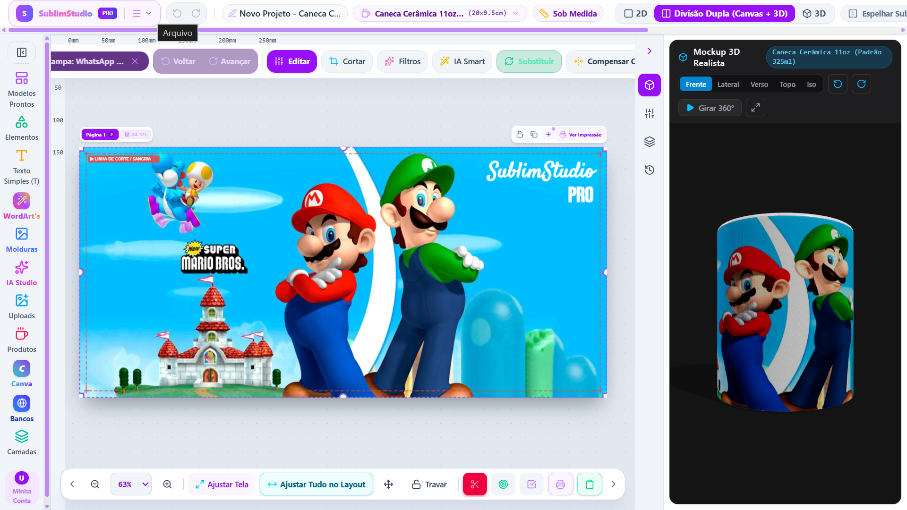
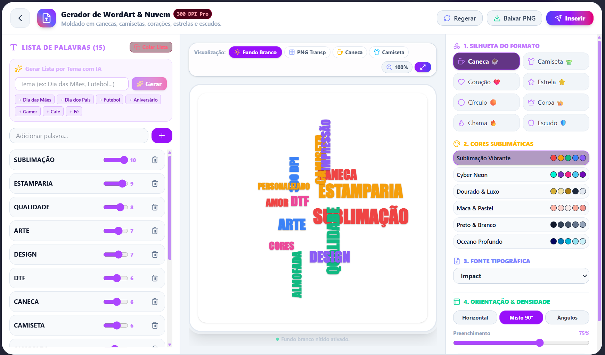
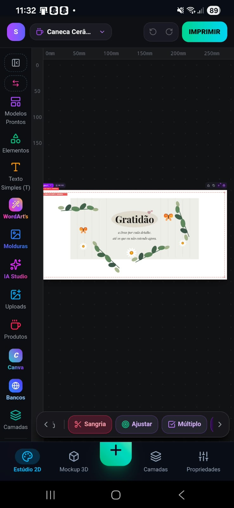
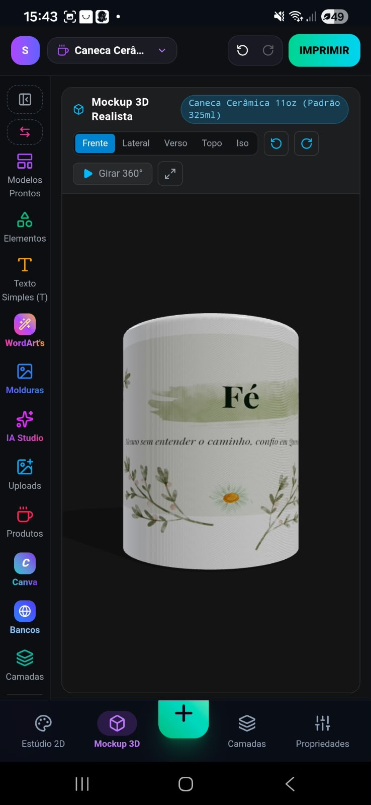

  <a href="#-português-pt-br">🇧🇷 PT-BR</a> ·
  <a href="#-english-en">🇺🇸 EN</a> ·
  <a href="#-español-es">🇪🇸 ES</a> ·
  <a href="#-français-fr">🇫🇷 FR</a> ·
  <a href="#-العربية-ar">🇸🇦 AR</a> ·
  <a href="#-deutsch-de">🇩🇪 DE</a> ·
  <a href="#-日本語-ja">🇯🇵 JA</a> ·
  <a href="#-中文-zh">🇨🇳 ZH</a> ·
  <a href="#-한국어-ko">🇰🇷 KO</a> ·
  <a href="#-русский-ru">🇷🇺 RU</a>

  

<h1 align="center">SublimStudio Pro</h1>

<strong>Do desenho à peça pronta. Criação visual, personalização e preparação para sublimação em um só espaço.</strong>

  <a href="https://sublimstudio-pro.web.app">🚀 Acessar aplicação</a> ·
  <a href="https://github.com/ruitobias-eng/AI-Sublimation-Studio-Pro">💻 Repositório GitHub</a>

---
🇧🇷 Português (PT-BR)
Sobre o projeto
O SublimStudio Pro, desenvolvido pela diBiTech®, é uma plataforma de criação visual voltada a profissionais e negócios de sublimação, personalização, estamparia, brindes e design gráfico. A proposta é integrar criação e edição 2D, ferramentas tipográficas, geração de elementos gráficos, recursos de IA, visualização 3D e preparação de artes para impressão.
Desenvolvimento: diBiTech®  
Desenvolvedores: Rui Tobias Carvalho e Rodrigo Carvalho.
Recursos e ferramentas
Editor 2D: canvas, camadas, guias, alinhamento, transformação, rotação, redimensionamento, agrupamento, desfazer/refazer, margens e sangria.
WordArt Studio PRO: textos curvados e circulares, arcos, selos, efeitos 3D, neon, metálicos e suporte a fontes OTF, TTF, WOFF2 e Google Fonts.
Nuvem de Palavras: composições em formatos como caneca, camiseta, coração, estrela, círculo, coroa, chama e escudo, com controles de frequência, densidade, orientação e paleta.
QR Code Art: QR Codes para links, Wi-Fi, WhatsApp, e-mail e VCard, com exportação SVG/PNG e personalização visual.
AI Studio: ferramentas de geração de imagens com estilos e temas como floral aquarela, cyberpunk, anime, pets e profissões.
Recursos de imagem: upload, transparência, imagens e elementos gráficos para inserção no editor.
Mockup 3D: pré-visualização de artes em produtos, com vistas frontal, lateral, traseira, superior, isométrica e visualização 360°, usando Three.js/WebGL.
Central de Impressão: preparação de trabalhos, formatos de papel, organização de artes, nesting, marcas de corte e espelhamento para sublimação.
Sublimação e produtos
O fluxo contempla formatos personalizados, guias visuais, margens de segurança, sangria e preparação de arquivos em alta resolução. Entre os produtos e formatos previstos no fluxo estão canecas (11 oz, 10 oz e 3 oz), copos shot, canecas cônicas, camisetas, almofadas e outros itens personalizados. Capas de celular, incluindo modelos de iPhone, podem ser configuradas como produtos planos quando essa opção estiver disponível na versão utilizada.
Formatos citados pelo projeto: PNG com transparência, SVG e PDF. A indicação de 300 DPI deve ser conferida nas configurações e nos metadados do arquivo exportado; o resultado físico também depende das dimensões, do material, da impressora e do processo de produção.
Experiência em diferentes telas
Desktop: área de trabalho ampla, canvas central, ferramentas, propriedades e visualização 3D.
Tablet: painéis adaptáveis e controles por toque.
Mobile: interface adaptada a telas menores, ferramentas acessíveis por toque e prioridade para manter a arte visível.
> **Princípio de interface: Canvas sempre visível.**
Tecnologias
Área	Tecnologia
Interface	React + TypeScript
Build	Vite
Estilização	Tailwind CSS
Estado	Zustand
Gráficos 2D	Canvas API
Vetores	SVG
3D	Three.js + WebGL
Processamento	Web Workers
Aplicação	PWA
Galeria
As imagens abaixo usam os caminhos existentes no repositório. Caso algum arquivo não esteja presente em `docs/screenshots/`, remova a referência ou adicione a captura correspondente.
Interface principal	WordArt Studio PRO
	

Nuvem de palavras	Elementos e formas
	

Mockup 3D	Central de Impressão
	

Interface 15	Interface 16	Interface 17
		
Status do projeto
Em desenvolvimento ativo. Recursos, compatibilidade, desempenho e fluxos de produção evoluem continuamente. A disponibilidade de cada ferramenta pode variar conforme a versão publicada. Consulte a aplicação para verificar o comportamento atual antes de planejar uma produção.
Desenvolvimento
diBiTech® · Rui Tobias Carvalho · Rodrigo Carvalho
---
🇺🇸 English (EN)
About
SublimStudio Pro, developed by diBiTech®, is a visual creation platform for sublimation, product customization, apparel decoration, promotional products and graphic design professionals. It brings together 2D design and editing, typography tools, graphic generators, AI-assisted image creation, 3D previews and print preparation.
Developed by: diBiTech®  
Creators: Rui Tobias Carvalho and Rodrigo Carvalho.
Features and tools
2D Editor: canvas, layers, guides, alignment, object transforms, rotation, resizing, grouping, undo/redo, safe margins and bleed.
WordArt Studio PRO: curved and circular text, arcs, badges, 3D, neon and metallic effects; OTF, TTF, WOFF2 and Google Fonts.
Word Cloud: compositions shaped as mugs, T-shirts, hearts, stars, circles, crowns, flames and shields, with frequency, density, orientation and palette controls.
QR Code Art: QR codes for links, Wi-Fi, WhatsApp, email and vCards, with SVG/PNG output and visual customization.
AI Studio: image-generation tools and themes such as watercolor florals, cyberpunk, anime, pets and professions.
Image resources: uploads, transparency, images and graphic elements for use in the editor.
3D Mockups: product previews with front, side, back, top, isometric and 360° views, powered by Three.js/WebGL.
Print Hub: print preparation, paper formats, artwork organization, nesting, cut marks and sublimation mirroring.
Sublimation and products
The workflow supports custom formats, visual guides, safe margins, bleed and high-resolution artwork preparation. Product formats covered by the project include 11 oz, 10 oz and 3 oz mugs, shot cups, tapered mugs, T-shirts, pillows and other customizable items. Phone cases, including iPhone models, can be configured as flat products when supported by the version in use.
Project-listed output formats: transparent PNG, SVG and PDF. The 300 DPI value should be checked in export settings and in the exported file metadata. Final print quality also depends on dimensions, substrate, printer and production process.
Responsive experience
Desktop: spacious workspace, central canvas, tools, properties and 3D preview.
Tablet: adaptive panels and touch controls.
Mobile: layouts adapted to smaller screens, touch-accessible tools and an emphasis on keeping the artwork visible.
> **Interface principle: Keep the canvas visible.**
Technology
Area	Technology
UI	React + TypeScript
Build	Vite
Styling	Tailwind CSS
State management	Zustand
2D graphics	Canvas API
Vector graphics	SVG
3D	Three.js + WebGL
Processing	Web Workers
Application	PWA
Screenshots
The following images reference paths in the repository. If a file is missing from `docs/screenshots/`, remove its reference or add the matching screenshot.
Main interface	WordArt Studio PRO
	

Word cloud	Elements and shapes
	

3D mockup	Print Hub
	

Interface 15	Interface 16	Interface 17
		
Project status
Active development. Features, compatibility, performance and production workflows continue to evolve. Availability may vary by published version. Check the application before relying on a feature in a production workflow.
Development
diBiTech® · Rui Tobias Carvalho · Rodrigo Carvalho
---
🇪🇸 Español (ES)
Sobre el proyecto
SublimStudio Pro, desarrollado por diBiTech®, es una plataforma de creación visual para profesionales de sublimación, personalización de productos, estampación, artículos promocionales y diseño gráfico. Integra diseño y edición 2D, herramientas tipográficas, generadores gráficos, creación de imágenes asistida por IA, vistas previas 3D y preparación para impresión.
Desarrollo: diBiTech®  
Creadores: Rui Tobias Carvalho y Rodrigo Carvalho.
Funciones y herramientas
Editor 2D: canvas, capas, guías, alineación, transformación, rotación, cambio de tamaño, agrupación, deshacer/rehacer, márgenes de seguridad y sangrado.
WordArt Studio PRO: texto curvo y circular, arcos, sellos, efectos 3D, neón y metálicos; fuentes OTF, TTF, WOFF2 y Google Fonts.
Nube de palabras: composiciones con formas de taza, camiseta, corazón, estrella, círculo, corona, llama y escudo; controles de frecuencia, densidad, orientación y paletas.
QR Code Art: códigos QR para enlaces, Wi-Fi, WhatsApp, correo electrónico y vCard, con salida SVG/PNG y personalización visual.
AI Studio: herramientas de generación de imágenes con temas como floral acuarela, cyberpunk, anime, mascotas y profesiones.
Recursos gráficos: carga de archivos, transparencia, imágenes y elementos para insertar en el editor.
Mockups 3D: vistas frontal, lateral, trasera, superior, isométrica y 360°, con Three.js/WebGL.
Central de Impresión: preparación de trabajos, formatos de papel, organización de diseños, nesting, marcas de corte y espejado para sublimación.
Sublimación y productos
El flujo contempla formatos personalizados, guías visuales, márgenes de seguridad, sangrado y preparación de diseños en alta resolución. Incluye formatos para tazas de 11 oz, 10 oz y 3 oz, vasos shot, tazas cónicas, camisetas, almohadas y otros productos personalizables. Las fundas para móviles, incluidos modelos de iPhone, pueden configurarse como productos planos cuando la versión utilizada ofrezca esa opción.
Formatos de salida mencionados por el proyecto: PNG con transparencia, SVG y PDF. El valor de 300 DPI debe comprobarse en la configuración y en los metadatos del archivo exportado. El resultado impreso también depende de las dimensiones, el material, la impresora y el proceso de producción.
Diseño adaptable
Escritorio: espacio amplio, canvas central, herramientas, propiedades y vista 3D.
Tableta: paneles adaptables y controles táctiles.
Móvil: interfaz adaptada a pantallas pequeñas, herramientas táctiles y prioridad para mantener visible el diseño.
> **Principio de interfaz: el canvas siempre visible.**
Tecnologías
Área	Tecnología
Interfaz	React + TypeScript
Build	Vite
Estilos	Tailwind CSS
Estado	Zustand
Gráficos 2D	Canvas API
Vectores	SVG
3D	Three.js + WebGL
Procesamiento	Web Workers
Aplicación	PWA
Galería
Las imágenes utilizan rutas del repositorio. Si algún archivo no existe en `docs/screenshots/`, elimina su referencia o añade la captura correspondiente.
Interfaz principal	WordArt Studio PRO
	

Nube de palabras	Elementos y formas
	

Mockup 3D	Central de Impresión
	

Interfaz 15	Interfaz 16	Interfaz 17
		
Estado
En desarrollo activo. Las funciones, la compatibilidad, el rendimiento y los flujos de producción siguen evolucionando. La disponibilidad puede variar según la versión publicada. Comprueba la aplicación antes de depender de una función en producción.
Desarrollo
diBiTech® · Rui Tobias Carvalho · Rodrigo Carvalho
---
🇫🇷 Français (FR)
À propos
SublimStudio Pro, développé par diBiTech®, est une plateforme de création visuelle destinée aux professionnels de la sublimation, de la personnalisation, du textile, des objets promotionnels et du design graphique. Elle réunit la création et l’édition 2D, la typographie, les générateurs graphiques, la création d’images assistée par IA, les aperçus 3D et la préparation à l’impression.
Développement : diBiTech®  
Créateurs : Rui Tobias Carvalho et Rodrigo Carvalho.
Fonctionnalités
Éditeur 2D : canevas, calques, repères, alignement, transformation, rotation, redimensionnement, groupes, annuler/rétablir, marges de sécurité et fond perdu.
WordArt Studio PRO : textes courbes et circulaires, arcs, badges, effets 3D, néon et métalliques ; polices OTF, TTF, WOFF2 et Google Fonts.
Nuage de mots : compositions en forme de tasse, t-shirt, cœur, étoile, cercle, couronne, flamme et bouclier, avec réglages de fréquence, densité, orientation et couleurs.
QR Code Art : QR codes pour liens, Wi-Fi, WhatsApp, e-mail et vCard, avec export SVG/PNG et personnalisation.
AI Studio : génération d’images autour de thèmes tels que floral aquarelle, cyberpunk, anime, animaux et professions.
Ressources visuelles : import de fichiers, transparence, images et éléments graphiques.
Maquettes 3D : vues de face, latérale, arrière, supérieure, isométrique et à 360°, avec Three.js/WebGL.
Centre d’impression : préparation, formats papier, organisation des visuels, nesting, repères de coupe et miroir pour sublimation.
Sublimation et produits
Le flux prévoit des formats personnalisés, des repères visuels, des marges de sécurité, du fond perdu et la préparation en haute résolution. Les formats de produits comprennent notamment des mugs 11 oz, 10 oz et 3 oz, des verres shot, des mugs coniques, des t-shirts, des coussins et d’autres objets personnalisables. Les coques de téléphone, y compris certains modèles iPhone, peuvent être configurées comme produits plats lorsque cette option est disponible.
Formats de sortie mentionnés : PNG transparent, SVG et PDF. La valeur de 300 DPI doit être vérifiée dans les paramètres et les métadonnées du fichier exporté. Le résultat dépend également des dimensions, du support, de l’imprimante et du procédé de production.
Interface adaptative
Ordinateur : espace de travail large, canevas central, outils, propriétés et aperçu 3D.
Tablette : panneaux adaptatifs et commandes tactiles.
Mobile : interface adaptée aux petits écrans, outils tactiles et priorité à la visibilité du visuel.
> **Principe : garder le canevas visible.**
Technologies
Domaine	Technologie
Interface	React + TypeScript
Build	Vite
Styles	Tailwind CSS
État	Zustand
Graphismes 2D	Canvas API
Vectoriel	SVG
3D	Three.js + WebGL
Traitement	Web Workers
Application	PWA
Captures d’écran
Les images utilisent les chemins du dépôt. Si un fichier manque dans `docs/screenshots/`, supprimez sa référence ou ajoutez la capture correspondante.
Interface principale	WordArt Studio PRO
	

Nuage de mots	Éléments et formes
	

Maquette 3D	Centre d’impression
	

Interface 15	Interface 16	Interface 17
		
État du projet
Développement actif. Les fonctionnalités, la compatibilité, les performances et les flux de production évoluent. La disponibilité peut varier selon la version publiée. Vérifiez l’application avant d’utiliser une fonction dans un processus de production.
Développement
diBiTech® · Rui Tobias Carvalho · Rodrigo Carvalho
---
🇸🇦 العربية (AR)
نبذة عن المشروع
SublimStudio Pro، المطوّر بواسطة diBiTech®، هو منصة للتصميم المرئي موجهة إلى محترفي الطباعة بالتسامي وتخصيص المنتجات والطباعة على الملابس والهدايا الترويجية والتصميم الجرافيكي. تجمع المنصة بين تحرير التصميم ثنائي الأبعاد وأدوات الطباعة الفنية وإنشاء العناصر الرسومية وتوليد الصور بمساعدة الذكاء الاصطناعي ومعاينة المنتجات ثلاثية الأبعاد وتجهيز ملفات الطباعة.
التطوير: diBiTech®  
المطوران: Rui Tobias Carvalho وRodrigo Carvalho.
الأدوات والميزات
محرر 2D: مساحة تصميم، طبقات، أدلة ومحاذاة، تحويل العناصر وتدويرها وتغيير حجمها وتجميعها، تراجع وإعادة، هوامش آمنة ونزف الطباعة.
WordArt Studio PRO: نصوص منحنية ودائرية وأقواس وأختام وتأثيرات ثلاثية الأبعاد ونيون وتأثيرات معدنية، مع دعم OTF وTTF وWOFF2 وGoogle Fonts.
سحابة الكلمات: تكوينات بأشكال كوب وقميص وقلب ونجمة ودائرة وتاج ولهب ودرع، مع التحكم في التكرار والكثافة والاتجاه والألوان.
QR Code Art: رموز QR للروابط وشبكات Wi-Fi وWhatsApp والبريد الإلكتروني وvCard، مع تصدير SVG/PNG وتخصيص المظهر.
AI Studio: أدوات لتوليد الصور بموضوعات مثل الزهور بالألوان المائية وCyberpunk وAnime والحيوانات الأليفة والمهن.
موارد الصور: تحميل الملفات ودعم الشفافية وإضافة الصور والعناصر الرسومية إلى المحرر.
معاينة ثلاثية الأبعاد: عرض أمامي وجانبي وخلفي وعلوي وإيزومتري ودوران 360 درجة باستخدام Three.js/WebGL.
مركز الطباعة: تجهيز الأعمال ومقاسات الورق وتنظيم التصاميم وNesting وعلامات القص وعكس التصميم للطباعة بالتسامي.
التسامي والمنتجات
يدعم سير العمل المقاسات المخصصة والأدلة المرئية وهوامش الأمان والنزف وتجهيز التصاميم بدقة عالية. تشمل تنسيقات المنتجات أكواب 11 و10 و3 أونصات وأكواب Shot وأكواب مخروطية وقمصان ووسائد ومنتجات أخرى قابلة للتخصيص. يمكن إعداد أغطية الهواتف، بما فيها بعض طرازات iPhone، كمنتجات مسطحة عندما يتوفر هذا الخيار في الإصدار المستخدم.
صيغ الإخراج المذكورة: PNG بخلفية شفافة وSVG وPDF. يجب التحقق من قيمة 300 DPI في إعدادات التصدير وبيانات الملف الناتج. وتعتمد نتيجة الطباعة أيضًا على الأبعاد والخامة والطابعة وطريقة الإنتاج.
التوافق مع الشاشات
الحاسوب: مساحة عمل واسعة ولوحة تصميم مركزية وأدوات وخصائص ومعاينة ثلاثية الأبعاد.
الجهاز اللوحي: لوحات قابلة للتكيف وعناصر تحكم باللمس.
الهاتف: واجهة ملائمة للشاشات الصغيرة وأدوات تعمل باللمس مع أولوية لإبقاء التصميم ظاهرًا.
> **مبدأ الواجهة: إبقاء مساحة التصميم مرئية.**
التقنيات
المجال	التقنية
الواجهة	React + TypeScript
البناء	Vite
التنسيق	Tailwind CSS
إدارة الحالة	Zustand
الرسومات ثنائية الأبعاد	Canvas API
الرسومات المتجهة	SVG
ثلاثي الأبعاد	Three.js + WebGL
المعالجة	Web Workers
التطبيق	PWA
لقطات الشاشة
تستخدم الصور المسارات الموجودة في المستودع. إذا لم يكن أحد الملفات موجودًا في `docs/screenshots/`، فاحذف مرجعه أو أضف الصورة المطابقة.
الواجهة الرئيسية	WordArt Studio PRO
	

سحابة الكلمات	العناصر والأشكال
	

معاينة 3D	مركز الطباعة
	

الواجهة 15	الواجهة 16	الواجهة 17
		
حالة المشروع
قيد التطوير النشط. تستمر إضافة الميزات وتحسين التوافق والأداء وسير عمل الإنتاج. قد يختلف توفر الأدوات حسب الإصدار المنشور. يرجى اختبار التطبيق قبل الاعتماد على أي ميزة في الإنتاج.
التطوير
diBiTech® · Rui Tobias Carvalho · Rodrigo Carvalho
---
🇩🇪 Deutsch (DE)
Über das Projekt
SublimStudio Pro von diBiTech® ist eine visuelle Kreativplattform für Fachleute aus Sublimationsdruck, Produktpersonalisierung, Textilveredelung, Werbeartikeln und Grafikdesign. Sie verbindet 2D-Gestaltung und -Bearbeitung, Typografie-Werkzeuge, Grafikgeneratoren, KI-gestützte Bildgestaltung, 3D-Vorschauen und Druckvorbereitung.
Entwicklung: diBiTech®  
Entwickler: Rui Tobias Carvalho und Rodrigo Carvalho.
Funktionen und Werkzeuge
2D-Editor: Canvas, Ebenen, Hilfslinien, Ausrichtung, Transformation, Drehung, Größenänderung, Gruppierung, Rückgängig/Wiederholen, Sicherheitsränder und Beschnitt.
WordArt Studio PRO: gebogene und kreisförmige Texte, Bögen, Siegel, 3D-, Neon- und Metalleffekte; OTF-, TTF-, WOFF2- und Google-Fonts.
Wortwolke: Formen wie Becher, T-Shirt, Herz, Stern, Kreis, Krone, Flamme und Schild mit Einstellungen für Häufigkeit, Dichte, Ausrichtung und Farbpaletten.
QR Code Art: QR-Codes für Links, WLAN, WhatsApp, E-Mail und vCard, mit SVG/PNG-Ausgabe und visueller Anpassung.
AI Studio: Bildgenerierung mit Themen wie Aquarell-Blumen, Cyberpunk, Anime, Haustiere und Berufe.
Bildressourcen: Datei-Uploads, Transparenz sowie Bilder und Grafikelemente für den Editor.
3D-Mockups: Vorder-, Seiten-, Rück-, Ober- und isometrische Ansicht sowie 360°-Ansicht mit Three.js/WebGL.
Druckzentrale: Druckvorbereitung, Papierformate, Anordnung von Motiven, Nesting, Schnittmarken und Spiegelung für Sublimationsdruck.
Sublimation und Produkte
Der Workflow umfasst benutzerdefinierte Formate, visuelle Hilfslinien, Sicherheitsränder, Beschnitt und die Vorbereitung hochauflösender Motive. Zu den Produktformaten gehören 11-oz-, 10-oz- und 3-oz-Becher, Shotgläser, konische Becher, T-Shirts, Kissen und weitere personalisierbare Produkte. Handyhüllen, einschließlich iPhone-Modellen, können als flache Produkte eingerichtet werden, sofern diese Option in der verwendeten Version verfügbar ist.
Vom Projekt genannte Ausgabeformate: PNG mit Transparenz, SVG und PDF. Der Wert von 300 DPI sollte in den Exporteinstellungen und den Metadaten der exportierten Datei geprüft werden. Das Druckergebnis hängt außerdem von Abmessungen, Material, Drucker und Produktionsverfahren ab.
Responsives Design
Desktop: großer Arbeitsbereich, zentrale Zeichenfläche, Werkzeuge, Eigenschaften und 3D-Vorschau.
Tablet: anpassbare Bedienfelder und Touch-Steuerung.
Mobil: für kleine Displays angepasste Oberfläche, Touch-Werkzeuge und möglichst dauerhaft sichtbares Motiv.
> **UI-Prinzip: Die Zeichenfläche bleibt sichtbar.**
Technologien
Bereich	Technologie
Oberfläche	React + TypeScript
Build	Vite
Styling	Tailwind CSS
Zustand	Zustand
2D-Grafik	Canvas API
Vektoren	SVG
3D	Three.js + WebGL
Verarbeitung	Web Workers
Anwendung	PWA
Screenshots
Die Bilder verweisen auf Pfade im Repository. Fehlt eine Datei in `docs/screenshots/`, entfernen Sie den Verweis oder fügen Sie den passenden Screenshot hinzu.
Hauptoberfläche	WordArt Studio PRO
	

Wortwolke	Elemente und Formen

	

3D-Mockup	Druckzentrale
	

Oberfläche 15	Oberfläche 16	Oberfläche 17
		
Projektstatus
Aktive Entwicklung. Funktionen, Kompatibilität, Leistung und Produktionsabläufe werden kontinuierlich weiterentwickelt. Die Verfügbarkeit kann je nach veröffentlichter Version variieren. Bitte prüfen Sie die Anwendung, bevor Sie eine Funktion im Produktionsprozess voraussetzen.
Entwicklung
diBiTech® · Rui Tobias Carvalho · Rodrigo Carvalho
---
🇯🇵 日本語 (JA)
プロジェクト概要
diBiTech® が開発する SublimStudio Pro は、昇華転写、製品カスタマイズ、アパレル印刷、販促品、グラフィックデザイン向けのビジュアル制作プラットフォームです。2D編集、タイポグラフィ、グラフィック生成、AI画像生成、3Dプレビュー、印刷データの準備を一つの作業環境にまとめます。
開発: diBiTech®  
開発者: Rui Tobias Carvalho、Rodrigo Carvalho
主な機能
2Dエディター: キャンバス、レイヤー、ガイド、整列、変形、回転、サイズ変更、グループ化、元に戻す/やり直し、安全マージン、塗り足し。
WordArt Studio PRO: カーブ文字、円形文字、アーチ、バッジ、3D・ネオン・メタリック効果。OTF、TTF、WOFF2、Google Fontsに対応。
ワードクラウド: マグカップ、Tシャツ、ハート、星、円、王冠、炎、盾などの形状。頻度、密度、向き、配色を調整できます。
QR Code Art: URL、Wi-Fi、WhatsApp、メール、vCard用QRコード。SVG/PNG出力と外観のカスタマイズ。
AI Studio: 水彩フローラル、サイバーパンク、アニメ、ペット、職業などのテーマを使った画像生成ツール。
画像素材: ファイルのアップロード、透明画像、画像やグラフィック素材のエディターへの挿入。
3Dモックアップ: Three.js/WebGLによる正面、側面、背面、上面、アイソメトリック、360度プレビュー。
印刷センター: 印刷準備、用紙サイズ、デザイン配置、ネスティング、トンボ、昇華転写用の左右反転。
昇華転写と製品
カスタムサイズ、ガイド、安全マージン、塗り足し、高解像度データの準備を想定したワークフローです。製品形式には11 oz・10 oz・3 ozマグカップ、ショットカップ、テーパー形状のカップ、Tシャツ、クッションなどが含まれます。iPhoneを含むスマートフォンケースは、使用中のバージョンで対応している場合、平面製品として設定できます。
プロジェクトで記載されている出力形式: 透過PNG、SVG、PDF。300 DPIはエクスポート設定と出力ファイルのメタデータで確認してください。実際の印刷結果は、寸法、素材、プリンター、製造工程にも左右されます。
レスポンシブ対応
デスクトップ: 広い作業領域、中央キャンバス、ツール、プロパティ、3Dプレビュー。
タブレット: 調整可能なパネルとタッチ操作。
モバイル: 小さな画面に合わせたUI、タッチ対応ツール、作品を見やすく保つ設計。
> **UIの基本方針: キャンバスを常に見える状態に。**
技術
分野	技術
UI	React + TypeScript
ビルド	Vite
スタイル	Tailwind CSS
状態管理	Zustand
2D描画	Canvas API
ベクター	SVG
3D	Three.js + WebGL
処理	Web Workers
アプリ	PWA
スクリーンショット
画像はリポジトリ内のパスを参照しています。`docs/screenshots/` にファイルが存在しない場合は、参照を削除するか該当画像を追加してください。
メイン画面	WordArt Studio PRO
	

ワードクラウド	素材と図形
	

3Dモックアップ	印刷センター
	

画面15	画面16	画面17
		
プロジェクト状況
開発継続中。 機能、互換性、パフォーマンス、制作ワークフローは継続的に改善されています。利用可能な機能は公開バージョンによって異なる場合があります。本番作業で利用する前に、アプリで動作をご確認ください。
開発
diBiTech® · Rui Tobias Carvalho · Rodrigo Carvalho
---
🇨🇳 中文 (ZH)
项目简介
SublimStudio Pro 由 diBiTech® 开发，是面向热升华打印、产品定制、服装印花、促销礼品和图形设计从业者的视觉创作平台。平台整合了 2D 设计与编辑、字体工具、图形生成、AI 图像创作、3D 预览和印刷文件准备流程。
开发方： diBiTech®  
开发者： Rui Tobias Carvalho、Rodrigo Carvalho。
功能与工具
2D 编辑器： 画布、图层、辅助线、对齐、对象变换、旋转、缩放、分组、撤销/重做、安全边距和出血。
WordArt Studio PRO： 弯曲文字、环形文字、弧形、徽章、3D、霓虹和金属效果；支持 OTF、TTF、WOFF2 和 Google Fonts。
文字云： 可生成杯子、T 恤、爱心、星形、圆形、皇冠、火焰和盾牌等形状，并调整频率、密度、方向和配色。
QR Code Art： 为链接、Wi-Fi、WhatsApp、电子邮件和 vCard 创建二维码，支持 SVG/PNG 输出和视觉自定义。
AI Studio： 提供图像生成工具，主题包括水彩花卉、赛博朋克、动漫、宠物和职业。
图像资源： 文件上传、透明图像，以及可插入编辑器的图片和图形元素。
3D 样机： 使用 Three.js/WebGL 展示正面、侧面、背面、顶部、等轴测和 360° 视图。
印刷中心： 印前准备、纸张规格、图稿排版、自动拼版、裁切标记和热升华镜像。
热升华与产品
工作流程涵盖自定义尺寸、视觉辅助线、安全边距、出血和高分辨率图稿准备。项目涉及的产品规格包括 11 oz、10 oz 和 3 oz 马克杯、Shot 杯、锥形杯、T 恤、靠垫及其他定制产品。若当前版本支持，手机壳（包括 iPhone 型号）可配置为平面产品。
项目提及的输出格式： 透明 PNG、SVG 和 PDF。请在导出设置和导出文件元数据中核实 300 DPI。最终印刷效果还取决于尺寸、材料、打印机和生产工艺。
响应式体验
桌面端： 宽敞工作区、中央画布、工具、属性面板和 3D 预览。
平板端： 自适应面板和触控操作。
移动端： 适配小屏幕的界面、触控工具，并优先保持作品可见。
> **界面原则：让画布始终可见。**
技术栈
领域	技术
界面	React + TypeScript
构建	Vite
样式	Tailwind CSS
状态管理	Zustand
2D 图形	Canvas API
矢量图形	SVG
3D	Three.js + WebGL
处理	Web Workers
应用	PWA
截图
以下图片引用仓库中的路径。如果 `docs/screenshots/` 中缺少某个文件，请删除对应引用或添加正确截图。
主界面	WordArt Studio PRO
	

文字云	元素与形状
	

3D 样机	印刷中心
	

界面 15	界面 16	界面 17
		
项目状态
持续开发中。 功能、兼容性、性能和生产流程仍在不断完善。不同发布版本的功能可用性可能有所差异。用于实际生产前，请先在应用中确认相关功能。
开发
diBiTech® · Rui Tobias Carvalho · Rodrigo Carvalho
---
🇰🇷 한국어 (KO)
프로젝트 소개
diBiTech®가 개발한 SublimStudio Pro는 승화전사, 제품 커스터마이징, 의류 프린팅, 판촉물 및 그래픽 디자인 전문가를 위한 비주얼 제작 플랫폼입니다. 2D 디자인 및 편집, 타이포그래피 도구, 그래픽 생성기, AI 이미지 제작, 3D 미리보기와 인쇄 준비 기능을 하나의 작업 공간에 통합합니다.
개발: diBiTech®  
개발자: Rui Tobias Carvalho, Rodrigo Carvalho.
주요 기능
2D 편집기: 캔버스, 레이어, 가이드, 정렬, 객체 변형, 회전, 크기 조절, 그룹화, 실행 취소/다시 실행, 안전 여백 및 도련.
WordArt Studio PRO: 곡선 및 원형 텍스트, 아치, 배지, 3D·네온·메탈 효과. OTF, TTF, WOFF2 및 Google Fonts 지원.
워드 클라우드: 머그컵, 티셔츠, 하트, 별, 원, 왕관, 불꽃, 방패 형태의 구성과 빈도·밀도·방향·색상 팔레트 설정.
QR Code Art: 링크, Wi-Fi, WhatsApp, 이메일, vCard용 QR 코드 생성 및 SVG/PNG 출력, 시각적 사용자 지정.
AI Studio: 수채화 꽃, 사이버펑크, 애니메이션, 반려동물, 직업 등의 테마를 활용한 이미지 생성 도구.
이미지 리소스: 파일 업로드, 투명 이미지, 편집기에 삽입할 이미지 및 그래픽 요소.
3D 목업: Three.js/WebGL 기반 정면, 측면, 후면, 상단, 아이소메트릭 및 360° 미리보기.
인쇄 센터: 인쇄 준비, 용지 규격, 디자인 배치, 네스팅, 재단 표시 및 승화전사용 좌우 반전.
승화전사 및 제품
사용자 지정 규격, 시각 가이드, 안전 여백, 도련 및 고해상도 디자인 준비를 지원하는 작업 흐름을 지향합니다. 프로젝트에서 다루는 제품 규격에는 11 oz, 10 oz, 3 oz 머그컵, 샷 컵, 원뿔형 컵, 티셔츠, 쿠션 및 기타 맞춤형 제품이 포함됩니다. 사용 중인 버전에서 지원하는 경우 iPhone을 포함한 휴대폰 케이스를 평면 제품으로 설정할 수 있습니다.
프로젝트에 명시된 출력 형식: 투명 PNG, SVG, PDF. 300 DPI는 내보내기 설정과 출력 파일의 메타데이터에서 확인해야 합니다. 실제 인쇄 결과는 크기, 소재, 프린터 및 제작 공정에도 영향을 받습니다.
반응형 경험
데스크톱: 넓은 작업 공간, 중앙 캔버스, 도구, 속성 패널 및 3D 미리보기.
태블릿: 조정 가능한 패널과 터치 컨트롤.
모바일: 작은 화면에 맞춘 UI, 터치 도구, 디자인을 계속 볼 수 있도록 하는 데 중점.
> **UI 원칙: 캔버스를 항상 보이게 유지합니다.**
기술
영역	기술
UI	React + TypeScript
빌드	Vite
스타일	Tailwind CSS
상태 관리	Zustand
2D 그래픽	Canvas API
벡터	SVG
3D	Three.js + WebGL
처리	Web Workers
애플리케이션	PWA
스크린샷
이미지는 저장소 경로를 참조합니다. `docs/screenshots/`에 파일이 없다면 해당 참조를 제거하거나 올바른 이미지를 추가하세요.
메인 인터페이스	WordArt Studio PRO
	

워드 클라우드	요소 및 도형
	

3D 목업	인쇄 센터
	

인터페이스 15	인터페이스 16	인터페이스 17
		
프로젝트 상태
활발히 개발 중입니다. 기능, 호환성, 성능 및 제작 흐름은 계속 개선됩니다. 기능 제공 여부는 배포 버전에 따라 달라질 수 있으므로 실제 제작에 사용하기 전에 앱에서 확인하세요.
개발
diBiTech® · Rui Tobias Carvalho · Rodrigo Carvalho
---
🇷🇺 Русский (RU)
О проекте
SublimStudio Pro, разработанный diBiTech®, — это платформа визуального творчества для специалистов по сублимационной печати, персонализации продукции, нанесению изображений на текстиль, рекламным сувенирам и графическому дизайну. Она объединяет 2D-редактирование, инструменты типографики, генераторы графики, создание изображений с помощью ИИ, 3D-просмотр и подготовку макетов к печати.
Разработка: diBiTech®  
Разработчики: Rui Tobias Carvalho и Rodrigo Carvalho.
Возможности и инструменты
2D-редактор: холст, слои, направляющие, выравнивание, трансформация, поворот, изменение размера, группировка, отмена/повтор, безопасные поля и вылеты.
WordArt Studio PRO: изогнутый и круговой текст, дуги, эмблемы, 3D-, неоновые и металлические эффекты; шрифты OTF, TTF, WOFF2 и Google Fonts.
Облако слов: композиции в форме кружки, футболки, сердца, звезды, круга, короны, пламени и щита; настройка частоты, плотности, ориентации и палитры.
QR Code Art: QR-коды для ссылок, Wi-Fi, WhatsApp, электронной почты и vCard, экспорт SVG/PNG и визуальная настройка.
AI Studio: инструменты генерации изображений с темами акварельной флористики, киберпанка, аниме, домашних животных и профессий.
Графические ресурсы: загрузка файлов, прозрачность, изображения и элементы для редактора.
3D-мокапы: виды спереди, сбоку, сзади, сверху, изометрический и 360° просмотр на базе Three.js/WebGL.
Центр печати: подготовка к печати, форматы бумаги, размещение макетов, nesting, метки реза и зеркальное отражение для сублимации.
Сублимация и продукция
Рабочий процесс предусматривает пользовательские размеры, визуальные направляющие, безопасные поля, вылеты и подготовку макетов высокого разрешения. Среди форматов продукции указаны кружки 11, 10 и 3 oz, стопки, конические кружки, футболки, подушки и другие изделия для персонализации. Чехлы для телефонов, включая модели iPhone, можно настраивать как плоские изделия, если такая возможность доступна в используемой версии.
Указанные проектом форматы вывода: PNG с прозрачностью, SVG и PDF. Значение 300 DPI необходимо проверять в настройках экспорта и метаданных готового файла. Итог печати также зависит от размеров, материала, принтера и производственного процесса.
Адаптивный интерфейс
Компьютер: просторная рабочая область, центральный холст, инструменты, свойства и 3D-просмотр.
Планшет: адаптивные панели и сенсорное управление.
Мобильные устройства: интерфейс для небольших экранов, сенсорные инструменты и приоритет видимости макета.
> **Принцип интерфейса: холст всегда остается видимым.**
Технологии
Область	Технология
Интерфейс	React + TypeScript
Сборка	Vite
Стили	Tailwind CSS
Состояние	Zustand
2D-графика	Canvas API
Векторная графика	SVG
3D	Three.js + WebGL
Обработка	Web Workers
Приложение	PWA
Скриншоты
Изображения ссылаются на пути в репозитории. Если файла нет в `docs/screenshots/`, удалите ссылку или добавьте соответствующий скриншот.
Главный интерфейс	WordArt Studio PRO
	

Облако слов	Элементы и фигуры
	

3D-мокап	Центр печати
	

Интерфейс 15	Интерфейс 16	Интерфейс 17
		
Статус проекта
Активная разработка. Функции, совместимость, производительность и производственные процессы продолжают улучшаться. Доступность инструментов зависит от опубликованной версии. Перед использованием в производстве проверьте работу нужной функции в приложении.
Разработка
diBiTech® · Rui Tobias Carvalho · Rodrigo Carvalho
---

  <strong>SublimStudio Pro · diBiTech®</strong> 
  Do desenho à peça pronta.

